# Multi-Agent Supply Chain Decision System

[](https://github.com/adwitiya-pandey/multi-agent-supply-chain-system/actions/workflows/ci.yml)


> A production-grade five-agent CrewAI pipeline enforcing deterministic math, Pydantic message schemas, strict task guardrails, and an external human-in-the-loop approval gate for retail inventory replenishment.

---

## Architecture Diagram

```mermaid
flowchart TD
    %% -------------------------------------------------------------------------
    %% Class Styles
    %% -------------------------------------------------------------------------
    classDef ingress fill:#e0f2fe,stroke:#0284c7,stroke-width:1.5px,color:#0f172a;
    classDef trigger fill:#e0e7ff,stroke:#4f46e5,stroke-width:1.5px,color:#0f172a;
    classDef agent fill:#ede9fe,stroke:#7c3aed,stroke-width:1.5px,color:#0f172a;
    classDef guardrail fill:#dcfce7,stroke:#16a34a,stroke-width:1.5px,color:#0f172a;
    classDef policy fill:#fef3c7,stroke:#d97706,stroke-width:1.5px,color:#0f172a;
    classDef blocked fill:#fee2e2,stroke:#dc2626,stroke-width:1.5px,color:#0f172a;
    classDef hitl fill:#fae8ff,stroke:#a855f7,stroke-width:1.5px,color:#0f172a;
    classDef storage fill:#f1f5f9,stroke:#475569,stroke-width:1.5px,color:#0f172a;

    %% -------------------------------------------------------------------------
    %% 1. Ingress & Read-Only Ground Truth
    %% -------------------------------------------------------------------------
    subgraph LayerIngress ["1. Ingress & Read-Only Ground Truth"]
        direction TB
        S_Scenarios["Scenario Contracts<br/>data/scenarios/S01..S10.json"]
        S_BuildDB["Database Builder<br/>scripts/build_db.py"]
        S_SupplyDB[("data/supply.db (Read-Only Ground Truth)<br/>3-Layer Security: mode=ro | PRAGMA query_only=ON | SQLite Authorizer")]
        S_Sanitize["sanitize.py (Ingress Sanitizer)<br/>Untrusted Text Tagging & Prompt Injection Defense"]

        S_Scenarios --> S_BuildDB --> S_SupplyDB
        S_SupplyDB -.-> S_Sanitize
    end

    %% -------------------------------------------------------------------------
    %% 2. Cycle Entry Point
    %% -------------------------------------------------------------------------
    P_RunCycle["run_cycle(request, cycle_id)<br/>Contextvars: cycle_id, sku_id, warehouse_id"]

    %% -------------------------------------------------------------------------
    %% 3. CrewAI 5-Agent Cognitive Pipeline
    %% -------------------------------------------------------------------------
    subgraph LayerCrewAI ["2. CrewAI Sequential Cognitive Pipeline (Process.sequential)"]
        direction TB

        A1["1. Demand Forecaster<br/>Tools: get_demand_stats, get_market_signals"]
        G1{"Guardrail 1: Statistics Check<br/>ForecastMessage numbers == recomputed stats"}

        A2["2. Inventory Planner<br/>Tools: get_inventory_position, calculate_reorder_plan"]
        G2{"Guardrail 2: Deterministic Math<br/>InventoryPlanMessage == planning.py formulas"}

        A3["3. Supplier Liaison<br/>Tools: get_supplier_options"]
        G3{"Guardrail 3: Terms & Pack Sizing<br/>SupplierMessage: vendor active, MOQ, pack, total"}

        A4["4. Quality Assurance<br/>Tools: run_consistency_checks"]
        G4{"Guardrail 4: QA Consistency Rules<br/>QAReport contains all QA01..QA14 findings"}

        A5["5. Escalation Manager<br/>Pure Reasoning: Risk & Confidence Evaluation"]
        M5["EscalationDecision<br/>Suggests STANDARD, SENIOR, or EXECUTIVE"]

        CB_CostGuard["task_callback: CostGuard<br/>Per-agent token tracking × pricing<br/>Budget Ceiling: $0.50 per cycle"]

        A1 -->|Emits| G1
        G1 -->|Pydantic Message| A2
        A2 -->|Emits| G2
        G2 -->|Pydantic Message| A3
        A3 -->|Emits| G3
        G3 -->|Pydantic Message| A4
        A4 -->|Emits| G4
        G4 -->|Pydantic Message| A5
        A5 -->|Emits| M5
    end

    %% -------------------------------------------------------------------------
    %% 4. Deterministic Policy Floor & Outcome Routing
    %% -------------------------------------------------------------------------
    subgraph LayerPolicy ["3. Deterministic Policy Floor & Outcome Routing"]
        direction TB
        Pol_Floor["src/supplychain/policy.py<br/>Deterministic Escalation Floor"]
        Pol_Max["final_level = max(policy_level, llm_level)<br/>Safety: LLM can only raise caution, never lower"]
        Pol_Router{"Cycle Status Router"}

        Status_Terminal["BLOCKED | FAILED | BUDGET_EXCEEDED | NO_ACTION_NEEDED<br/>Cycle saved to app.db (Approval disabled)"]
        Status_Pending["PENDING_APPROVAL<br/>Replenishment PO drafted for reviewer"]

        Pol_Floor -->|policy_level| Pol_Max
        Pol_Max --> Pol_Router
        Pol_Router -->|Terminal or No Action| Status_Terminal
        Pol_Router -->|Replenishment Order| Status_Pending
    end

    %% -------------------------------------------------------------------------
    %% 5. Human-in-the-Loop Approval Gate (AST Boundary)
    %% -------------------------------------------------------------------------
    subgraph LayerHITL ["4. Human-in-the-Loop Approval Gate (AST-Enforced Boundary)"]
        direction TB
        UI_Streamlit["Streamlit Dashboard (src/supplychain/app.py)<br/>Reviewer inspects metrics, PO draft, vendor email, QA"]
        UI_Decision{"Human Decision Gate"}
        UI_Reject["Decision: REJECTED<br/>Reviewer note captured in app.db"]
        UI_Approve["Decision: APPROVED<br/>Reviewer identity validated"]

        App_Module["src/supplychain/approvals.py (Deterministic Logic)<br/>AST Boundary: Never imported by CrewAI/agents"]
        App_Finalise["store.finalise_po()<br/>Appends immutable purchase order"]

        UI_Streamlit --> UI_Decision
        UI_Decision -->|Reject| UI_Reject
        UI_Decision -->|Approve| UI_Approve
        UI_Approve --> App_Module --> App_Finalise
    end

    %% -------------------------------------------------------------------------
    %% 6. Immutable Persistence & Observability
    %% -------------------------------------------------------------------------
    subgraph LayerStorage ["5. Immutable Persistence & Observability Layer"]
        direction TB
        DB_App[("data/app.db (SQLite Event Store)<br/>Append-Only: cycles, human_decisions, purchase_orders<br/>SQL Triggers reject UPDATE and DELETE with ABORT")]
        Obs_Audit["audit/audit.jsonl<br/>Fail-Closed Structured JSONL Audit Log"]
        Obs_Logs["logs/app.log<br/>Context-Bound Sanitized JSON Logs (structlog)"]
        Obs_Traces["Observability & Tracing<br/>LangSmith OTel Hook & Local Trace Spans"]
    end

    %% -------------------------------------------------------------------------
    %% Cross-Layer Edges
    %% -------------------------------------------------------------------------
    P_RunCycle --> A1
    S_SupplyDB -.->|Read-Only Queries| A1
    S_SupplyDB -.->|Read-Only Queries| A2
    S_SupplyDB -.->|Read-Only Queries| A3
    S_SupplyDB -.->|Read-Only Queries| A4

    G4 -->|Deterministic Findings| Pol_Floor
    M5 -->|llm_level| Pol_Max

    CB_CostGuard -.->|Halts cycle on breach| Status_Terminal

    Status_Pending --> UI_Streamlit
    Status_Terminal --> DB_App
    Status_Terminal --> Obs_Audit

    UI_Reject --> DB_App
    UI_Reject --> Obs_Audit
    App_Finalise --> DB_App
    App_Finalise --> Obs_Audit

    P_RunCycle -.-> Obs_Logs
    P_RunCycle -.-> Obs_Traces

    %% -------------------------------------------------------------------------
    %% Class Assignments
    %% -------------------------------------------------------------------------
    class S_Scenarios,S_BuildDB,S_SupplyDB,S_Sanitize ingress;
    class P_RunCycle trigger;
    class A1,A2,A3,A4,A5 agent;
    class G1,G2,G3,G4,M5,CB_CostGuard guardrail;
    class Pol_Floor,Pol_Max,Pol_Router,Status_Pending policy;
    class Status_Terminal blocked;
    class UI_Streamlit,UI_Decision,UI_Reject,UI_Approve,App_Module,App_Finalise hitl;
    class DB_App,Obs_Audit,Obs_Logs,Obs_Traces storage;
```



---

## What This Proves (and What It Does Not)

*Per SPEC Section 17:*
- **What this proves**: Validates pipeline wiring, strongly-typed Pydantic schemas, strict guardrail intercepts, deterministic mathematical ownership of numbers, automated policy escalation floors, AST-enforced human approval gates, denial-of-wallet cost guards, and immutable event persistence across 10 simulated edge scenarios.
- **What this does not prove**: Offline scripted evaluation does not prove that Gemini will generate eloquent natural language explanations, exercise optimal subjective vendor negotiations, or behave predictably under native function calling without prompt drift. Live execution (T14) exercises the live Gemini model against these exact guardrails.

---

## Quickstart (Copy-Paste)

### Prerequisites
- Linux / WSL2 Ubuntu, macOS, or Windows
- Python 3.13 (`uv` package manager installed: `curl -LsSf https://astral.sh/uv/install.sh | sh` on Linux/macOS or `irm https://astral.sh/uv/install.ps1 | iex` on Windows PowerShell)
- **Automatic Python Provisioning**: `uv` automatically downloads and manages Python 3.13 if not present on your system (`uv python install 3.13` if needed).
- **Python version**: `pyproject.toml` pins `>=3.13,<3.14`. Python 3.12 and Python 3.14 will be rejected by `uv sync`. Always use Python 3.13.

### Quickstart Commands & Expected Output

#### Linux / macOS / WSL2 (bash)

```bash
# 1. Clone the repository
git clone https://github.com/adwitiya-pandey/multi-agent-supply-chain-system.git
cd multi-agent-supply-chain-system

# 2. Install dependencies with locked resolution (uv will provision Python 3.13 automatically)
uv sync
```
*Expected output:*
```text
Resolved 168 packages in 2ms
Audited 168 packages in 0.2ms
```

```bash
# 3. Configure environment file (offline mode runs out of the box)
cp .env.example .env

# 4. Build synthetic supply database
uv run python scripts/build_db.py
```
*Expected output:*
```text
Database successfully built at data/supply.db for scenario S01
```

```bash
# 5. Run the 10 scenarios offline (writes to reports/scenario_results.md)
uv run python scripts/run_scenarios.py --mode oracle --out reports/scenario_results.md
```
*Expected output:*
```text
Running 10 scenarios in mode='oracle'...
{"scenario_id": "S01", "event": "cycle_started", "sku_id": "SKU0001", "cycle_id": "CYC-...", "warehouse_id": "WH-N", "level": "info", "timestamp": "..."}
[S01] Normal replenishment                -> Status: PENDING_APPROVAL Level: STANDARD (0.27s)
[S02] Primary supplier insolvent          -> Status: PENDING_APPROVAL Level: SENIOR   (0.40s)
[S03] Demand spike                        -> Status: PENDING_APPROVAL Level: SENIOR   (0.25s)
[S04] Conflicting forecasts               -> Status: PENDING_APPROVAL Level: SENIOR   (0.28s)
[S05] Supplier delay plus hostile note    -> Status: PENDING_APPROVAL Level: SENIOR   (0.23s)
[S06] Stockout                            -> Status: PENDING_APPROVAL Level: SENIOR   (0.21s)
[S07] Overstock                           -> Status: NO_ACTION_NEEDED Level: STANDARD (0.22s)
[S08] High-value PO                       -> Status: PENDING_APPROVAL Level: SENIOR   (0.34s)
[S09] Missing data                        -> Status: BLOCKED          Level: BLOCKED  (0.24s)
[S10] Malformed LLM output                -> Status: FAILED           Level: BLOCKED  (0.19s)

Scenario results written to: reports/scenario_results.md
Trace summaries compiled to reports/trace_summary.md and reports/traces/
```

```bash
# 6. Generate the token and cost analysis report (writes to reports/cost_report.md)
uv run python scripts/cost_report.py --out reports/cost_report.md
```
*Expected output:*
```text
Cost report successfully generated at: reports/cost_report.md
```

```bash
# 7. Start the human-in-the-loop Streamlit dashboard
uv run streamlit run src/supplychain/app.py
```
*Expected output:*
```text
  You can now view your Streamlit app in your browser.

  Local URL: http://localhost:8501
  Network URL: http://...
```

#### Windows (PowerShell)

```powershell
# 1. Clone the repository
git clone https://github.com/adwitiya-pandey/multi-agent-supply-chain-system.git
cd multi-agent-supply-chain-system

# 2. Install dependencies with locked resolution (uv will provision Python 3.13 automatically)
uv sync

# 3. Configure environment file (offline mode runs out of the box)
Copy-Item .env.example .env

# 4. Build synthetic supply database
uv run python scripts/build_db.py

# 5. Run the 10 scenarios offline (writes to reports/scenario_results.md)
uv run python scripts/run_scenarios.py --mode oracle --out reports/scenario_results.md

# 6. Generate the token and cost analysis report (writes to reports/cost_report.md)
uv run python scripts/cost_report.py --out reports/cost_report.md

# 7. Start the human-in-the-loop Streamlit dashboard
uv run streamlit run src/supplychain/app.py
```

### What You Should See in the Streamlit Dashboard (S01 Approval Flow)

Follow this step-by-step checklist to verify the full decision cycle and approval gate in the dashboard (`http://localhost:8501`):

1. **Sidebar Configuration**:
   - [ ] Mode banner indicates: `⚠️ SCRIPTED DEMO: outputs are deterministic, not Gemini` (or `ℹ️ LIVE MODE` if `LLM_MODE=gemini`).
   - [ ] Under **Reviewer Profile**, enter your name (default: `Alice Reviewer`).
   - [ ] Under **Trigger Pipeline Cycle**, select Scenario `S01` (SKU `SKU0001`, Warehouse `WH-N`).
   - [ ] Click **Run Decision Cycle**; verify a spinner displays `Executing 5-agent decision cycle...`, followed by a green toast: `Cycle completed: CYC-XXXXXXXX-XXXX (PENDING_APPROVAL)`.

2. **Pending Approvals Tab (`📋 Pending Approvals`)**:
   - [ ] Select the newly created cycle from the dropdown.
   - [ ] **Cycle Overview Metrics**: Status `PENDING_APPROVAL`, Scenario `S01`, Policy Level `STANDARD`, Final Level `STANDARD`.
   - [ ] **Expander 1 (Demand Forecast)**: Daily Demand Mean `10.000` (Method A: `10.000`, Method B: `10.000`), Coverage `100.0%`, Confidence `0.90`, Flags: `None`.
   - [ ] **Expander 2 (Inventory Position & Reorder Plan)**: On-Hand `50`, Safety Stock `19`, Reorder Point `89`, Needed Quantity `109`, Action `ORDER`, Urgency `NORMAL`, Planned Supplier `SUP001`.
   - [ ] **Expander 3 (Supplier Selection & Draft Purchase Order)**: Chosen Supplier `SUP001`, Order Quantity `100 units` (rounded to supplier pack size 20, MOQ 50), Unit Cost `$32.79`, Total PO Value `$3,279.00`, Requested Delivery Date, Vendor Email Preview.
   - [ ] **Expander 4 (Quality Assurance & Consistency Audit)**: QA Verdict `PASS`, Success banner: `All automated consistency rules passed with 0 findings.`
   - [ ] **Expander 5 (Token Usage & Notional Cost)**: 5 agents executed with token counts and notional cost (~`$0.002400`).

3. **Human Decision Gate**:
   - [ ] Click the primary **Approve Purchase Order** button.
   - [ ] Verify the success banner: `Successfully APPROVED! Purchase Order PO-XXXXXXXX-XXXX finalized.`
   - [ ] Switch to the **Decision History (`📜 Decision History`)** tab to confirm the immutable record is stored in `app.db` with the reviewer name and approval timestamp.

---

## Live Gemini Mode

To run with live Google Gemini 3.8 Flash calls:

```bash
# 1. Export your Gemini API key (or add to .env)
export GEMINI_API_KEY="your-gemini-api-key"
export LLM_MODE="gemini"

# 2. Run scenarios with live model invocation (includes 3s pacing delay)
uv run python scripts/run_scenarios.py --live

# 3. View live token consumption and measured cost report
uv run python scripts/cost_report.py
```

---

## Scenario Evaluation Suite

Every scenario exercises specific business anomalies and security attacks:

| Scenario | Title | Description | Expected Status | Final Tier | QA Finding Codes |
|---|---|---|---|---|---|
| `S01` | Normal replenishment | Stock below ROP with ample cover; standard PO generated | `PENDING_APPROVAL` | `STANDARD` | None |
| `S02` | Primary supplier insolvent | Primary vendor insolvent; switches to backup vendor | `PENDING_APPROVAL` | `SENIOR` | `QA08`, `QA14` |
| `S03` | Demand spike | Recent 7-day sales surge 3x above 28-day baseline | `PENDING_APPROVAL` | `SENIOR` | `QA05`, `QA06`, `QA08`, `QA12` |
| `S04` | Conflicting forecasts | Linear trend line diverges >30% from moving average | `PENDING_APPROVAL` | `SENIOR` | `QA05`, `QA08`, `QA12` |
| `S05` | Supplier delay & hostile note | Vendor delayed with prompt injection string in notes | `PENDING_APPROVAL` | `SENIOR` | `QA08`, `QA13` |
| `S06` | Stockout | On-hand inventory is 0 units | `PENDING_APPROVAL` | `SENIOR` | `QA08` |
| `S07` | Overstock | On-hand inventory far exceeds ROP | `NO_ACTION_NEEDED` | `STANDARD` | None |
| `S08` | High-value PO | Order total exceeds $10,000 threshold | `PENDING_APPROVAL` | `SENIOR` | `QA09` |
| `S09` | Missing data | 60% of sales data missing (<80% coverage) | `BLOCKED` | `BLOCKED` | `QA07`, `QA12` |
| `S10` | Malformed LLM output | LLM returns arithmetic violations and invalid JSON | `FAILED` | `BLOCKED` | None |

---

## Measured Token & Cost Analysis

*Measured from autonomous scenario runs recorded in `docs/cost_report.md`:*

- **Total Analyzed Cycles**: 51
- **Aggregate Token Count**: 31,520 tokens (23,640 prompt, 7,880 completion)
- **Total Notional Cost**: $0.094560 USD (Average ~$0.0024 per cycle)
- **Governance Budget Ceiling**: $0.500000 USD per cycle

> [!IMPORTANT]
> **Cost numbers are notional (tokens × configured price); free-tier calls bill zero.**
> Free-tier Gemini 3.8 Flash calls incur $0.00 actual billing. Calculations use standard commercial reference rates of **$1.50 per 1M prompt tokens** and **$7.50 per 1M completion tokens** as defined in SPEC section 10.

| Agent Role | Prompt Tokens | Completion Tokens | Total Tokens | Notional Cost (USD) | Cost Share |
|---|---|---|---|---|---|
| `Demand Forecaster` | 4,920 | 1,640 | 6,560 | $0.019680 | 20.8% |
| `Inventory Planner` | 5,400 | 1,800 | 7,200 | $0.021600 | 22.8% |
| `Supplier Liaison` | 4,440 | 1,480 | 5,920 | $0.017760 | 18.8% |
| `Quality Assurance` | 4,440 | 1,480 | 5,920 | $0.017760 | 18.8% |
| `Escalation Manager` | 4,440 | 1,480 | 5,920 | $0.017760 | 18.8% |

---

## Structured Logging

The pipeline uses `structlog` to emit JSON-formatted logs both to standard output and to `logs/app.log`. All log entries pass through `sanitize_log_event()` to strictly enforce the security boundary (SPEC Section 14).

### Real Runtime Sample Line
```json
{"scenario_id": "S01", "event": "cycle_started", "sku_id": "SKU0001", "cycle_id": "CYC-20261027-1156", "warehouse_id": "WH-N", "level": "info", "timestamp": "2026-10-27T11:58:19.636999Z"}
```

In error scenarios (such as S10 malformed output), the error is truncated to avoid leaking raw input payloads:
```json
{"error": "ValidationError: 18 validation error(s); first: Field required", "event": "cycle_failed", "sku_id": "SKU0010", "cycle_id": "CYC-20261027-2295", "warehouse_id": "WH-N", "level": "error", "timestamp": "2026-10-27T11:58:22.982739Z"}
```

### Log Fields
- **Standard fields**: `timestamp` (ISO-8601 UTC), `level` (`info`, `error`, `warning`, `debug`), `event` (`cycle_started`, `cycle_failed`, `budget_exceeded`).
- **Context variables** (bound per cycle via `structlog.contextvars`): `cycle_id`, `sku_id`, `warehouse_id`.
- **Permitted domain fields**: `scenario_id`, `error`, `agent`, `task`, `supplier_id`, `po_id`, `status`, `policy_level`, `final_level`, `verdict`, `decision`, `reviewer`, `prompt_tokens`, `completion_tokens`, `total_tokens`, `cost_usd`, `budget_usd`, `duration_seconds`, `code`, `severity`, `finding_codes`, `sha256`, `count`, `retries`, `success`, `on_hand`, `on_order`, `reorder_point`, `target_level`, `safety_stock`, `needed_qty`, `qty`, `unit_cost`, `total`, `is_primary`, `moq`, `pack_size`, `lead_time_days`.
- **Forbidden fields** (automatically filtered and never logged): `note`, `notes`, `supplier_notes`, `reviewer_note`, `reviewer_notes`, `body`, `email_body`, `prompt`, `prompts`, `rationale`, `summary`, `gemini_api_key`, `api_key`, `secret`, `password`, `token`.

---

## Security Architecture Summary

1. **Deterministic Numbers**: Forecasts, safety stock, reorder points, order quantities, pack rounding, and PO totals come exclusively from `planning.py` and `checks.py`. Guardrails recalculate and fail-closed if LLM text disagrees.
2. **Architectural AST Isolation**: `approvals.py` and `finalise_po` can NEVER be imported by `pipeline.py`, `agents.py`, `tasks.py`, or `tools.py` (enforced via AST unit tests). Agents possess zero write tools.
3. **Prompt Injection Defense**: External notes from suppliers, market feeds, or reviewer input are sanitized via `sanitize.py`, stripped of control characters, regex-checked for injection vectors, wrapped in `<untrusted>` tags, and excluded from system prompts and audit logs.
4. **Three-Layer Database Defense**: Ground truth database `supply.db` is opened read-only using `mode=ro`, `PRAGMA query_only = ON`, and a SQLite authorizer blocking all write opcodes.
5. **Append-Only Decision Store**: `app.db` enforces immutability via SQLite triggers on `cycles`, `human_decisions`, and `purchase_orders` that reject `UPDATE` and `DELETE` queries with `ABORT` signals.
6. **Cost Guard**: `CostGuard` task callback enforces a strict $0.50 cycle ceiling, aborting execution immediately upon budget breach.

---

## Known Limitations

*Per SPEC Section 22:*
- **Synthetic Data**: Uses synthetic catalog and sales history (Meridian Home Goods).
- **Single-SKU Processing**: Each decision cycle processes a single SKU-warehouse pair; multi-SKU cross-docking is out of scope.
- **Simulated Communications**: Vendor emails are drafted as plain text; real SMTP dispatch is deliberately omitted.
- **Reviewer Identity**: Reviewer identity is a validated typed name string rather than enterprise SAML/OAuth SSO.
- **Inter-Task Cost Checks**: Token budget checks occur at task callback boundaries; runaway streaming tokens within a single call are bounded by `max_tokens`.
- **Deliberately Simple Demand Models**: Employs moving-average and linear trend baselines rather than high-dimensional neural time-series models.

---

## Repository Tree

```
.
├── .github/workflows/ci.yml         # CI workflow (coverage gate, scenarios, boundaries)
├── data/
│   └── scenarios/                   # JSON test scenario contracts (S01.json .. S10.json)
├── docs/
│   ├── architecture.md              # System decomposition and component design
│   ├── cost_report.snapshot.md      # Reference snapshot: token consumption and notional costs
│   ├── decisions.md                 # Architectural decision log (D1..D10)
│   ├── EXPLAIN-PLAIN-ENGLISH.md     # Plain English task explanations and interview summaries
│   ├── scenario_results.snapshot.md # Reference snapshot: 10-scenario evaluation table
│   ├── sdk_notes.md                 # Verified CrewAI, Pydantic, Streamlit SDK facts
│   ├── threat_model.md              # Threat model and security mitigations
│   ├── trace_summary.snapshot.md    # Reference snapshot: autonomous execution trace evidence
│   └── traces/                      # Detailed per-cycle trace spans (snapshots)
├── pyproject.toml                   # Project metadata and locked dependency pins
├── README.md                        # Master documentation
├── scripts/
│   ├── build_db.py                  # Ground truth SQLite database builder
│   ├── cost_report.py               # Aggregated cost reporting script
│   └── run_scenarios.py             # Scenario test runner (oracle and live modes)
├── src/supplychain/
│   ├── agents.py                    # CrewAI agent definitions
│   ├── app.py                       # Streamlit human-in-the-loop dashboard
│   ├── approvals.py                 # Deterministic approval gate (outside CrewAI)
│   ├── audit.py                     # Fail-closed JSONL audit logger
│   ├── checks.py                    # Deterministic QA consistency checks (QA01..QA14)
│   ├── config.py                    # Pydantic-settings configuration
│   ├── cost.py                      # CostGuard and token pricing math
│   ├── db.py                        # 3-layer read-only database accessor
│   ├── guardrails.py                # Pydantic task output guardrails
│   ├── llm.py                       # LLM factory (Gemini and ScriptedLLM)
│   ├── logging_setup.py             # Context-bound structlog setup
│   ├── models.py                    # Strict Pydantic inter-agent schemas
│   ├── pipeline.py                  # Cycle runner orchestrating the 5-agent crew
│   ├── planning.py                  # Deterministic forecasting and inventory formulas
│   ├── policy.py                    # Deterministic escalation policy floor
│   ├── sanitize.py                  # Prompt injection detection and untrusted wrapping
│   ├── scripted.py                  # Offline ReAct fake LLM implementation
│   ├── store.py                     # Append-only SQLite event store with triggers
│   ├── tasks.py                     # Sequential CrewAI task definitions
│   ├── tools.py                     # Parameterized read-only agent tools
│   └── tracing.py                   # LangSmith OpenTelemetry hook and local trace spans
└── tests/                           # 171 unit, scenario, UI, and boundary tests
```

---

## License

This project is licensed under the MIT License. See [LICENSE](LICENSE) for details.
